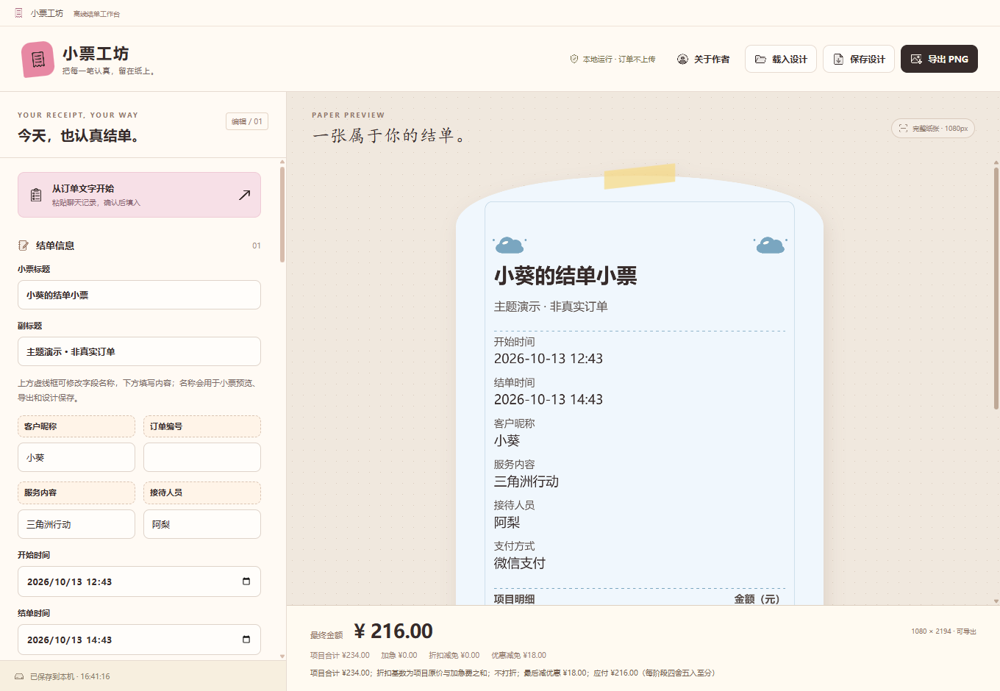

# 小票工坊 · Receipt Studio

[简体中文](README.md) | [English](README.en.md) | **日本語**

クラブの注文内容から精算用のレシート画像を作成する Windows デスクトップアプリです。注文を入力または貼り付け、かわいいテーマや画像素材を調整し、金額を確認してからレシート全体を PNG で保存できます。通常の利用に Node.js やオンライン編集サイトは必要ありません。

**[最新の Windows x64 インストーラーをダウンロード](https://github.com/Charlie-chulong/receipt-studio-desktop/releases/latest)** · [ソフトウェア利用許諾](SOFTWARE_LICENSE.txt) · [依存コンポーネントのライセンス](THIRD_PARTY_NOTICES.txt)

> ページ上部のリンクで README の言語を切り替えられます。アプリの画面は現在、簡体字中国語です。英語・日本語の README があることは、画面がその言語に対応していることを意味しません。



## 主な機能

- 明確な注文テキストから顧客情報、各項目の合計額、値引き、支払方法、開始・精算日時を抽出します。内容をプレビューし、確認してから適用します。
- 顧客、アカウント／番号、ゲーム／サービス、担当者の 4 項目について、表示名と内容を変更できます。
- 開始日時と精算日時を個別に入力できます。未入力の日時を自動で作り出すことはありません。以前のデザインに保存された精算日時も読み込めます。
- 10 種類のかわいいプリセットを用意しています：柔彩手账、奶油小票、草莓奶糖、薄荷软糖、蜜桃来信、奶油熊熊、樱桃气泡、柠檬汽水、晴空棉花、杏仁花园。
- 界面のアイコンは、本プロジェクトで AI 画像生成を使って制作・加工したローカル素材です。Lucide への依存は削除されています。
- 用紙の形状、配色、ローカルフォント、ロゴ、背景、下部の画像、ステッカーの位置・大きさ・回転を調整できます。
- 項目合計、特急料金、割引、値引きを計算し、計算過程を表示します。割引と値引きを適用する順序も設定できます。
- 現在の下書きをローカルに自動保存し、編集可能な JSON デザインを入出力できます。PNG はプレビュー画面のスクリーンショットではなく、幅 1080 ピクセルのレシート全体として出力されます。
- 固定の作者紹介、WeChat の連絡用 QR コード、任意の愛発電（Afdian）支援リンクを表示します。

プリセットを変更しても、注文内容、金額、追加した画像素材は消えません。変更した項目名、日時、画像素材はデザインと一緒に保存されます。

## ダウンロードとインストール

1. [Releases](https://github.com/Charlie-chulong/receipt-studio-desktop/releases/latest) を開きます。
2. `Receipt-Studio-1.0.1-Setup.exe` をダウンロードします。インストーラーを 3 言語の説明書やライセンス文書と一緒に配布する場合は、`Receipt-Studio-1.0.1-Share.zip` を選んでください。
3. Windows x64 上でインストーラーを実行し、インストール先を選択して「小票工坊」を起動します。

実行環境はインストーラーに含まれており、Node.js、npm、Git は不要です。このインストーラーにはコード署名がないため、Windows が発行元不明の警告を表示する場合があります。このリポジトリの Releases から取得し、`SHA256SUMS.txt` とファイルのハッシュを照合してください。インストールのためにセキュリティ保護を無効にしないでください。

今回提供するのは Windows x64 版のみです。macOS、Linux、Windows ARM64、スマートフォン向けのインストールパッケージは提供していません。

**1.0.1 の修正点：** 注文を貼り付けたとき、小計や受領済み金額をサービス明細に重複計上しなくなりました。デザインを読み込む際は現在の下書きを残せます。破損した画像で復元できない場合は自動保存を停止し、元の下書きをバックアップできます。

## 基本的な使い方

1. 注文を手入力するか、「从订单文字开始」（注文テキストから開始）を選択します。
2. 抽出結果を確認します。確認ボタンを押すまでは、現在の注文に適用されません。
3. 点線の入力欄で項目名を編集し、その下の欄に実際の内容を入力します。
4. 料金とデザインを調整し、レシートと金額の計算過程を確認します。
5. 「保存设计」で編集可能な JSON を、「导出 PNG」で共有用のレシート画像を保存します。

### 注文テキストの例

以下は形式を示すための架空のデータであり、実際の注文ではありません。

```text
老板：小葵
游戏：三角洲行动
客服：阿梨
开始时间：2026-10-13 12:43
结单时间：2026-10-13 14:43
三角洲护航 2小时 168元
指定陪玩 晚间档 66元
优惠18元
微信支付
```

予想される合計は `168 + 66 - 18 = 216.00` 元です。各行の末尾には、その項目の**合計額**を「元」または通貨記号付きで記載します。時間数を再度掛けることはありません。`小计100元`（小計）、`已收100元`（入金済み）、`实收100元`（実際の受取額）などの集計・入金情報は確認用の警告として表示され、項目に加算されず、支払状態の変更にも使われません。支払方法の記載は、入金済みであることを意味しません。曖昧な価格、状態、重複した項目には確認が必要です。貼り付け後もプレビューと明示的な確認が必要です。現在の抽出ルールは明確な中国語ラベルを対象とするもので、AI によるチャット理解サービスではありません。

### 金額と画像

- 金額は十進数で計算し、各計算段階で小数第 2 位まで四捨五入します。各行には時間単価や数量ではなく、項目全体の金額を入力します。
- 特急料金の倍率 `1.2` は、元の項目合計に 20% を加算する意味です。
- 割引欄は中国語の「折」方式です。`10` は割引なし、`9` は基準額の 90%、`8.5` は 85% を支払う設定です。
- 値引き額は適用対象の基準額を超えられません。不正な金額を黙ってゼロに補正することはありません。
- ローカルの PNG、JPG、WebP に対応しています。外部画像の URL や SVG は受け付けません。標準フォントは Microsoft YaHei です。SimSun や KaiTi は線が細く見える場合があります。

## ローカル処理とデータ

レシートの作成、編集、出力はインターネット接続なしで利用できます。注文内容、画像素材、デザインファイルは現在のコンピューター内で処理され、アプリがそれらをサーバーにアップロードすることはありません。

現在の下書きは、現在の Windows ユーザーのローカルアプリデータに保存されます。移行、バックアップ、複数の注文の保存には、JSON デザインを別途出力してください。自動保存は注文履歴データベースでもバックアップサービスでもありません。JSON には画像や注文情報が含まれる場合があるため、共有する前に確認してください。

自動保存される下書きは 1 件だけです。保存済み、または編集中のデザインを有効な JSON で置き換える前に確認画面が開きます。「取消，保留当前设计」で中止、「先另存当前设计」で現在のデザインを別ファイルに保存、「替换当前设计」で置き換えます。ファイルの読み取り中や確認待ちに現在のデザインを編集すると、その読み込みは無効になり、ファイルの選び直しが必要です。

下書きや画像素材の復元に失敗した場合は、編集・読み込み・自動保存をロックして元の `current` レコードを保護します。アプリを閉じて開き直しても、空白の内容で上書きしません。「重试恢复」で復元を再試行するか、「下载原始草稿备份」で保存先を指定して元のレコードを保存できます（ブラウザーの開発用プレビューでは、ブラウザーのダウンロード・名前を付けて保存の設定を使います）。元のバックアップは `receipt` と `savedAt` を含むローカルの JSON レコードです。データが破損している場合は、修復してから読み込む必要があります。バックアップの保存だけではロックは解除されません。「放弃原草稿，重新开始」を再確認した場合に限り、元のレコードを空白の下書きに置き換えて自動保存を再開します。通常のデザインのバックアップには、上部の「保存设计」を使います。どちらの JSON もローカルで生成され、注文情報や画像を含むため、安全に保管してください。

リポジトリには配布用の固定作者情報が含まれますが、利用者の下書き、注文ファイル、ローカルの検証用ディレクトリは含まれません。決済、資金の預かり、クラウドへの注文同期、税務用の請求書発行機能はありません。

## 作者と支援

作者は **楚龙（Chu Long）** です。クラブ向け WeChat ミニプログラムの開発や汎用版ミニプログラムを提供しています。連絡用の WeChat QR コードは、アプリの「关于作者」（作者について）で確認できます。

[愛発電で作者を支援する](https://afdian.com/a/chulong)。支援は完全に任意であり、アプリの無料利用には影響しません。

## 利用許諾と第三者の権利

本リポジトリではソースコードを公開していますが、**MIT などの標準的なオープンソースライセンスではありません**。オリジナルのアプリコードとソフトウェアの配布には、[SOFTWARE_LICENSE.txt](SOFTWARE_LICENSE.txt) が適用されます。

- オリジナルのアプリを無料で利用でき、商業注文のレシート作成にも使用できます。
- 利用許諾と依存コンポーネントのライセンスを保持した、完全かつ未変更のオリジナルインストーラー・共有用パッケージを無料で再配布できます。
- 転売、改名しての再販売、作者紹介や連絡用 QR コードを削除・隠蔽した状態での再配布は禁止されています。
- オリジナルソースコードのオープンソースとしての再利用や、別製品への再パッケージ配布は許諾されていません。その他の許諾は作者にお問い合わせください。

生成したレシート画像に作者の宣伝を付ける義務はありません。第三者の依存ライブラリにはそれぞれのライセンスが適用されます。詳細は [THIRD_PARTY_NOTICES.txt](THIRD_PARTY_NOTICES.txt) を参照してください。作者ページの David のファンアートには『サイバーパンク エッジランナーズ』のキャラクター権利が関係します。本プロジェクトはキャラクターや関連標章の商用利用権を付与せず、公式の承認・提携を示すものでもありません。

正式な利用許諾はリンク先の中国語文書です。この README は内容を理解するための概要です。

## ソースからの実行

利用許諾の範囲内でのみ実行してください。Windows x64、Node.js 22.12 以降の対応 LTS バージョン、npm を推奨します。

```bash
npm ci
npm test
npm run build
npm run prepare:desktop
npm start
```

Windows インストーラーを作成する場合：

```bash
npm run package:win
```

出力先は `release/` です。`build/` 内のアイコンはスクリプトで生成されます。`node_modules/`、`dist/`、`release/`、`.smoke/`、ローカルの検証用画像は Git に含めません。個人の注文、下書き、認証情報をコミットしないでください。

`npm run dev` でブラウザーの開発用プレビューを起動できます。ただし、デスクトップ版の作者情報取得やネイティブのファイル保存機能は完全には利用できず、インストール版の動作確認を代替するものではありません。

## 不具合の報告

このリポジトリの [Issues](https://github.com/Charlie-chulong/receipt-studio-desktop/issues) を利用できます。Windows のバージョン、アプリのバージョン、再現手順を記載してください。スクリーンショット、JSON、ログには、実際の顧客情報、支払い用 QR コード、パスワードなどの機密情報を含めないでください。
