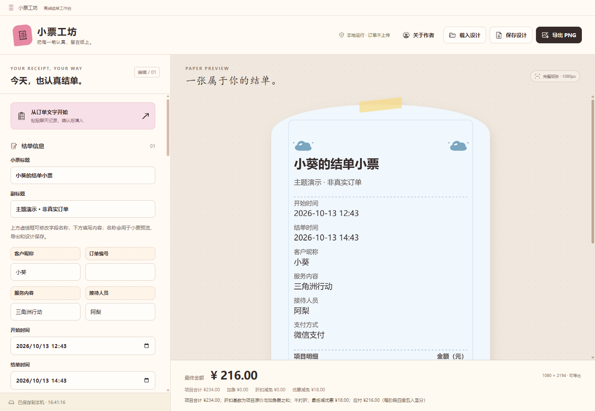

# 小票工坊 · Receipt Studio

**简体中文** | [English](README.en.md) | [日本語](README.ja.md)

Windows 桌面结单小票工具：填写或粘贴订单，调整可爱主题与素材，核对金额后导出完整图片。无需安装 Node.js，也无需打开在线编辑器。

**[下载最新 Windows x64 安装包](https://github.com/Charlie-chulong/receipt-studio-desktop/releases/latest)** · [使用授权](SOFTWARE_LICENSE.txt) · [依赖组件许可证](THIRD_PARTY_NOTICES.txt)

> 三份 README 可在顶部切换语言。软件界面目前为简体中文；英语和日语版本指的是文档，不代表已提供对应界面。



## 功能

- 从明确的订单文字提取客户、项目总价、优惠、支付方式及开始／结单时间，先预览，再由你确认应用。
- 自定义“老板／客户、账户／编号、游戏／服务、派单客服”四个字段的名称与内容。
- 分别填写开始时间和结单时间；留空的时间不会自动编造。旧设计原有的结单时间可继续读取。
- 提供 10 款可爱预设：柔彩手账、奶油小票、草莓奶糖、薄荷软糖、蜜桃来信、奶油熊熊、樱桃气泡、柠檬汽水、晴空棉花、杏仁花园。
- 界面图标由本项目通过 image 生成并整理为本地素材，不再依赖 Lucide 图标库。
- 调整纸张轮廓、颜色、本机字体、Logo、背景、底部图片及贴纸的位置、大小和旋转。
- 计算项目合计、加急费、折扣与优惠，显示计算过程，并允许设置折扣和优惠的应用顺序。
- 自动保存本机草稿；导入／导出设计 JSON；导出宽度为 1080 像素、包含完整票面的 PNG，而不是预览窗口截图。
- 固定作者介绍、微信联系二维码及自愿的爱发电支持入口。

切换主题只改变样式，不清空订单、金额或已上传素材。字段名称、时间与素材会随设计保存。

## 下载与安装

1. 打开 [Releases](https://github.com/Charlie-chulong/receipt-studio-desktop/releases/latest)。
2. 下载 `小票工坊-1.0.0-安装包.exe`，或下载包含安装包、三种语言说明和授权文件的分享 ZIP。
3. 在 Windows x64 上运行安装包，选择安装目录，完成后打开“小票工坊”。

安装包包含运行环境，普通使用不需要 Node.js、npm 或 Git。首次公开发布的安装包未做代码签名；Windows 可能提示来源未知。请从本仓库的 Releases 下载，并与发布页的 `SHA256SUMS.txt` 核对文件哈希，不要为了安装而关闭安全防护。

本次提供 Windows x64 安装包。未提供 macOS、Linux、Windows ARM64 或手机安装包。

## 基本使用

1. 手动填写订单，或点击“从订单文字开始”。
2. 核对提取候选；只有点击确认，候选才会覆盖当前订单。
3. 修改虚线输入框中的字段名称，在下方填写实际内容。
4. 调整费用和样式，检查右侧小票及底部金额计算过程。
5. 点击“保存设计”保留可编辑的 JSON；点击“导出 PNG”保存可分享的小票图片。

### 文字提取示例

以下仅演示格式，不是真实订单：

```text
老板：小葵
游戏：三角洲行动
客服：阿梨
开始时间：2026-10-13 12:43
结单时间：2026-10-13 14:43
三角洲护航 2小时 168元
指定陪玩 晚间档 66元
优惠18元
微信支付
```

预计金额为 `168 + 66 - 18 = 216.00` 元。每项行末写该项目的**总价**，并带“元”或货币符号；软件不会再乘时长。支付方式不代表已付款，含糊的价格、状态或重复字段会提示你核对。当前提取规则针对明确的中文标签，不是 AI 聊天理解服务。

### 金额与图片

- 金额以十进制计算，各计算阶段按四舍五入取到分。每行输入项目总价，不是数量或小时单价。
- 加急倍率为原价倍率，例如 `1.2` 表示在项目原价基础上加收 20%。
- 折扣使用中文“折”制：`10` 不打折，`9` 为原价的 90%，`8.5` 为原价的 85%。
- 优惠不能超过适用的金额基数；不会静默截断为零。
- 支持本机 PNG、JPG、WebP，不接受远程图片网址或 SVG。默认微软雅黑；选择宋体、楷体后，笔画可能更细。

## 本地运行与数据

无需联网即可制作、编辑和导出小票。订单内容、图片素材与设计文件在当前电脑中处理，软件不会将这些内容上传至服务器。

草稿保存在当前 Windows 用户的本机应用数据中。需要迁移、备份或保留不同订单时，请另存设计 JSON；自动草稿不是历史订单库，也不是备份服务。JSON 可能包含图片和订单信息，分享前请自行检查。

仓库中包含用于分发的固定作者资料，但不包含使用者的草稿、订单文件或本机验收目录。软件没有支付、资金托管、云端订单同步或税务发票开具功能。

## 作者与支持

作者：**楚龙**。提供俱乐部微信小程序开发服务，也有通用版小程序可供选择；微信联系二维码可在软件“关于作者”中查看。

[在爱发电支持作者](https://afdian.com/a/chulong)。支持完全自愿，不影响软件免费使用。

## 授权与第三方权利

本仓库公开源码供查看，**不等于采用 MIT 或其他标准开源许可证**。原创应用代码与软件分发遵循 [SOFTWARE_LICENSE.txt](SOFTWARE_LICENSE.txt)：

- 可以免费使用原版软件制作商业订单的小票。
- 可以免费转发完整、未修改的原版安装包与分享包，保留授权和依赖组件许可文本。
- 禁止倒卖、改名转售，或删除、遮挡作者介绍及联系二维码后再分发。
- 未授予原创源码的开源复用或重新包装分发许可；其他授权请联系作者。

生成的小票不强制附带作者宣传。第三方依赖保留各自的许可证；详见 [THIRD_PARTY_NOTICES.txt](THIRD_PARTY_NOTICES.txt)。作者页的 David 同人插画涉及《赛博朋克：边缘行者》角色权利，本项目不授予角色或相关标识的商业使用权，也不代表官方认可或联名。

## 从源码运行

仅限授权允许的用途。推荐 Windows x64、Node.js 22.12 及以上的 LTS 版本与 npm：

```bash
npm ci
npm test
npm run build
npm run prepare:desktop
npm start
```

构建 Windows 安装包：

```bash
npm run package:win
```

输出在 `release/`。`build/` 中的软件图标由脚本生成；`node_modules/`、`dist/`、`release/`、`.smoke/` 和本机验收图片不提交到 Git。不要将自己的订单、草稿或凭据加入仓库。

浏览器开发预览可使用 `npm run dev`，但它没有完整的桌面作者资料及原生文件保存接口，不能替代安装版验收。

## 反馈

可以通过本仓库的 [Issues](https://github.com/Charlie-chulong/receipt-studio-desktop/issues) 报告问题。请说明 Windows 版本、软件版本和复现步骤；截图、JSON 或日志中不要附带真实客户隐私、收款码、密码或其他敏感信息。
